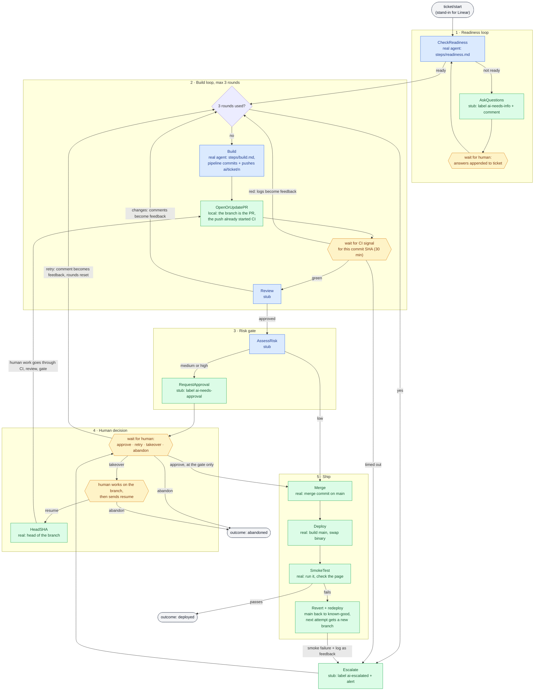
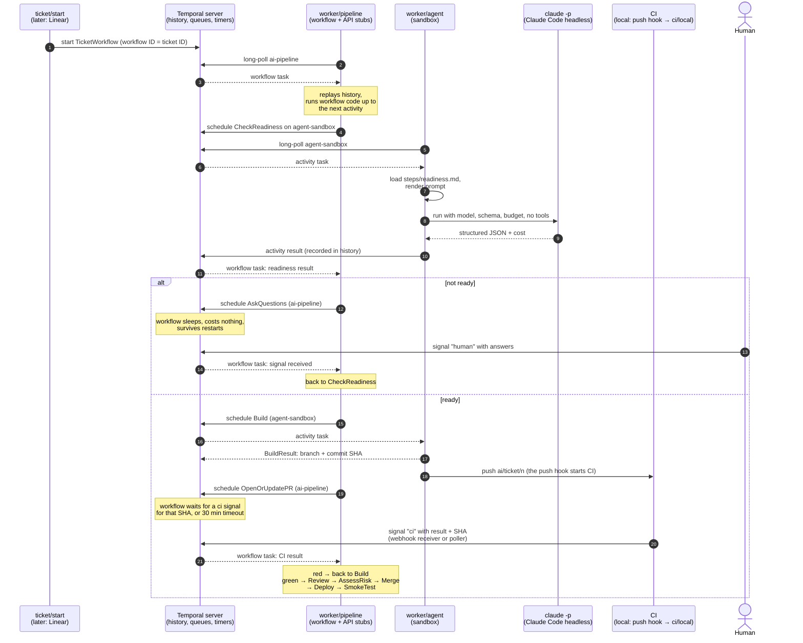

# Flow of work

Two views of the system as it is today (2026-10-29, after the real build/CI/deploy slice). Update these when the workflow
changes; `pipeline/workflow.go` is the source of truth.

## 1. One ticket through the workflow

Each box is a step in `TicketWorkflow`. Colour shows which worker runs it;
hexagons are where the workflow waits for something outside it: a human, or CI.

**Key:** blue = `worker/agent` (queue `agent-sandbox`) · green = `worker/pipeline`
(queue `ai-pipeline`) · amber = waiting on a signal: `human` (HumanInput) or `ci`
(CIResult). The "3 rounds used?" diamond is workflow logic, not a step.

There are no dead ends short of deployed or abandoned: escalation and the risk gate
both hand the decision to a human, and a taken-over ticket rejoins at the PR step,
so human work goes through the same CI, review and risk gate as agent work.

Not shown, because they're Temporal settings rather than steps: every activity
has a 10-minute `ScheduleToStartTimeout` (fails if no worker picks it up), retries
up to 3 times, and heartbeats while an agent runs.

## 2. Who talks to whom

The server never calls a worker. Workers pull work over outbound connections, so
they can run anywhere with a network path to the server. Every arrow into `S` is a
worker or client calling in.

## What's real vs stubbed

| Step | State |
|---|---|
| CheckReadiness | **Real**: Claude Code agent, `steps/readiness.md`, in a checkout of main with Read/Glob/Grep only |
| Build | **Real**: Claude Code agent, `steps/build.md`, in a checkout of the target. Edit tools plus `go test/vet/build/run` and `gofmt` only. The pipeline commits and pushes |
| CI | **Real**, local: the bare repo's post-receive hook runs `ci/local` (gofmt, vet, test on the pushed SHA), which signals `ci` |
| OpenOrUpdatePR | Local: the branch is the PR. On GitHub this opens a draft PR |
| HeadSHA, Merge, Revert | **Real**, local git against the bare repo |
| Deploy, SmokeTest | **Real**, local: build main into the deploy dir, run it, check the page |
| AskQuestions, RequestApproval, Escalate | Stub: logs what it would do in Linear |
| Review, AssessRisk | Stub: keywords in the ticket choose the path (`never-approve`, `migration`) |
